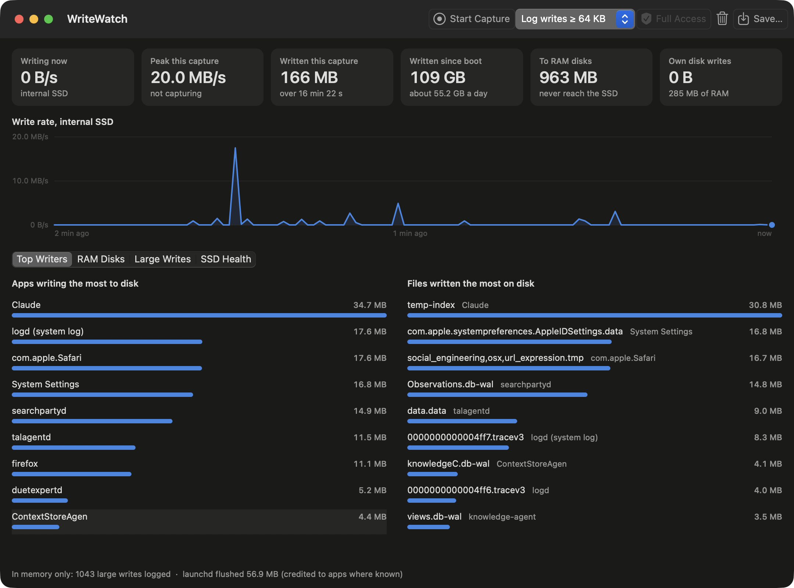

# WriteWatch

**See exactly what's writing to your Mac's SSD: which apps, which files, and how fast.**

Your Mac writes to its SSD all day, and Activity Monitor can't tell you what's going into which file. WriteWatch shows you live, in a fast native app with no dependencies, and it checks your drive's health too.



*Replay of a real 16-minute capture's large writes, with 963 MB of RAM disk writes kept out of the disk rankings.*

## Find out what's really writing

- **Live write rate:** current speed, a rolling 2-minute chart, the peak, and totals for the capture and since boot.
- **Top apps and files:** ranked by bytes written, updated every second, so a noisy app or a file being rewritten over and over stands out right away.
- **Large-writes log:** every write above a size you choose, from 4 KB to 16 MB, with the time, size, app and full path.
- **SSD health:** wear, spare capacity, media errors, temperature and lifetime totals, read directly from the drive with no `smartctl` required.
- **CSV export:** save the log or the totals whenever you want.

## It gets the blame right

Most tools tell you which process issued a write. That can point you at the wrong culprit, and WriteWatch was built to look past it.

**launchd gets blamed for everyone's writes.** On the Mac this was built on, `launchd` had been charged with 23.9 GB of writes since boot, the most of any process. Nearly all of what it wrote during a trace went to other programs' files, in a burst exactly every 30 seconds. WriteWatch credits those writes to the program that owns the file, working from who else wrote it and where it lives. It's a best guess, so the log always shows the process that issued the write too, and anything unclear is labeled as unattributed.

**RAM disks aren't your SSD.** In one real capture, StarCraft II looked like the biggest writer by far, with 965 MB logged. But 963 MB of that went to a RAM disk, and only 1.6 MB went anywhere else. WriteWatch asks macOS how each device is backed, so it spots RAM disks whatever they're named, gives them their own tab, and keeps them out of your disk rankings.

## Your capture stays in memory

Captures are held in RAM and go to disk only when you press Save. A disk-write monitor shouldn't add to the problem.

## Get started

You'll need macOS 13 or later and Xcode or its Command Line Tools. Build and open it:

```bash
./build.sh
```

```bash
open WriteWatch.app
```

The build is signed for your own Mac, and so far it's only been tested on one Apple Silicon machine.

## Permissions

WriteWatch asks for your administrator password when it opens, because per-file tracing uses `fs_usage`, which requires root. You can decline and still use part of the app:

| | With password | Without |
|---|---|---|
| Live write rate and disk totals | Yes | Yes |
| SSD health | Yes | Yes |
| Top apps | All processes | Your own processes |
| Top files and large-writes log | Yes | No |
| RAM disk separation | Yes | No |

## Why such a scary password prompt?

Because macOS only has one size of prompt. All WriteWatch needs is the output of one built-in Apple tool:

```bash
sudo fs_usage -w -f diskio
```

`fs_usage` traces disk activity across every process, so macOS requires root to run it. There's no permission for "just this one tool", and no privacy setting that covers it. The only option is the standard administrator prompt, the same one used for any request to run something as root, however small.

Your password goes to macOS, not to WriteWatch. The app asks the system to start the helper as root, and macOS shows the prompt and checks the password itself.

### What the helper does

`WriteWatchHelper` is the only part of WriteWatch that runs as root. It's about 150 lines of Swift in [`Sources/WriteWatchHelper/main.swift`](Sources/WriteWatchHelper/main.swift), so you can read all of it in a few minutes.

1. It connects back to the app on `127.0.0.1` and identifies itself with a one-time token.
2. When the app starts a capture, it runs `/usr/bin/fs_usage -w -f diskio` and sends the output to the app. The command is fixed in the code, so the app can't ask it to run anything else.
3. If `fs_usage` passes the memory limit, it restarts it.
4. When the connection closes, including if the app crashes, it stops the trace and exits.

It accepts only two commands from the app, start trace and stop trace. It only connects to your own Mac, it creates no files, and nothing stays installed afterward.

### What to keep in mind

- **It really does run as root.** macOS doesn't confine it to these actions; the limits come from what its code does. That's why it's kept small enough to read.
- **The trace covers the whole system.** File paths from every process pass through the helper to the app, and stay on your Mac unless you save them.
- **Keep the app somewhere safe.** The helper runs from inside the app bundle, so another program running under your account could swap it out before you approve the prompt. For regular use, put the app somewhere only administrators can write, such as `/Applications`.

### Why it asks every time

An installed background helper could skip the prompt, but it would need a signed release and would leave a root service on your Mac full time. WriteWatch runs as root only while it's open and leaves nothing behind, at the cost of one prompt per launch.

## Good to know

- **Memory:** `fs_usage` is memory-hungry, starting around 500 MB. WriteWatch restarts it past 1.5 GB, which misses a moment of writes, and tells you when that happens.
- **Process names:** `fs_usage` cuts them to 16 characters.
- **One trace at a time:** a capture can fail if another tool is using the kernel trace facility.
- **Wear figures:** the drive reports these itself, and how they're counted varies by manufacturer.
- **Drives:** the live rate and health stats cover the first SMART-capable NVMe drive.

## Under the hood

| Path | Contents |
|---|---|
| `Sources/WriteWatch` | AppKit app: window, charts, monitors, helper connection |
| `Sources/WriteWatchHelper` | The root helper |
| `Sources/WriteWatchCore` | `fs_usage` parser, write attribution, in-memory store, health verdicts |
| `Sources/CNVMeSMART` | C wrapper around IOKit's NVMe SMART interface |
| `Tests/WriteWatchCoreTests` | Unit tests, run with `swift test` |
